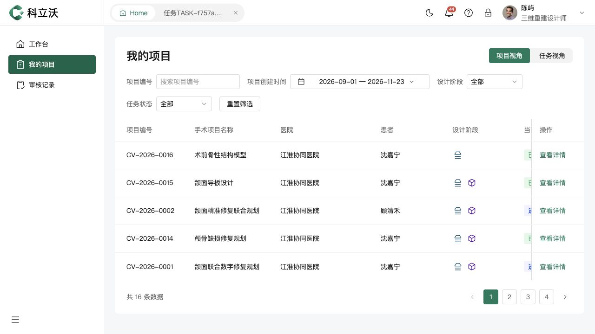
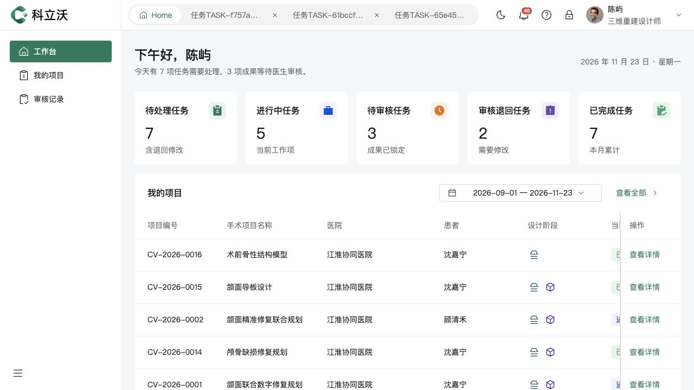
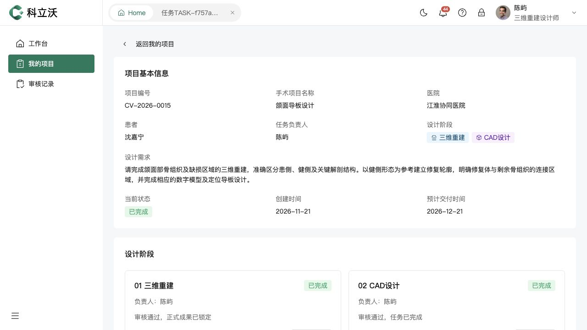
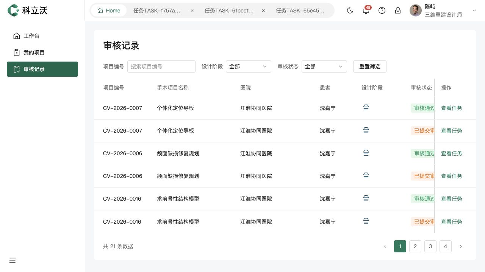

# 设计师端 V1 → V2 可审查变化（2026-11-23）

基线：GitHub旧design-handoff `3f4911050c6b21e496c20a809730ca70cdfcd8f9`（11月4日）。目标设计代码：`caa9947376ad04fa0ddfde92b5e6741f8de2f212`。本轮交付新增文档/部署防护不改UI。

**这是设计差异清单，不是将整个应用Diff交给开发覆盖。** 管理员和销售新增页面不计入设计师功能差异；账号、共享业务、公共样式为必要集成依赖，须单独评估。开发只合并需要的变更，不reset已有实现。

|分类|旧版 → 最新确认|涉及文件|开发动作与边界|
|---|---|---|---|
|首页摘要|最近项目/重要通知各3条，查看全部到二级列表；首页我的项目仍独立日期范围|ProjectPages、DashboardLists、App、routes|保留五卡布局；添加完整摘要列表入口，统计与目标任务集同源|
|项目视角字段|项目编号、医院、手术名称、患者标识、设计阶段、当前进展… → 项目编号、手术项目名称、医院、患者、设计阶段、当前状态、创建时间、预计交付时间、操作|ProjectPages、patientDisplay|患者显示有来源姓名，不再将内部患者标识当名字；表格阶段仅Icon，详情仍Tag|
|任务视角字段|原专业Tag/任务编号/负责人等列 → 与项目视角相同核心字段，单个阶段Icon|ProjectPages、projectModel|同项目多任务连续，四阶段排序，操作依独立Task.id和权限；不把相同项目号当任务主键|
|筛选|搜索名称/编号混合 → 项目编号；文本Input不带装饰搜索Icon；阶段/状态/日期保留|ProjectPages、RangeControl、App|项目和任务按所属业务编号搜索；切视角/筛选恢复有效第一页，统计来源日期与首页创建日期分开|
|分页/标题布局|完整项目表固定每页6条 → 按可用高度实测；项目/审核列表标题起点一致|tables/useViewportPagination、viewportTables.css、designerTables.css|复用销售既定完整列表规则，不强制首页动态分页；末页及稀疏数据自然收缩；操作文字与表头左对齐|
|审核记录|旧任务编号/名称等 → 项目编号、手术项目名称、医院、患者、设计阶段、审核状态、审核意见、审核人、审核时间、操作|App Reviews、reviewRecords|提交人与实际审核人分离；提交事件审核人显示-；仅审核事件、长意见省略Tooltip；按ID/提交ID去重，不重写真实审核历史|
|统一编号/数据|独立旧目录聚合 → linked-only时从统一服务授权读取|business/*、projectModel、App|Order.businessNo唯一展示源；Order→Project→Task稳定ID；不能改号伪关联、不能混入未关联旧目录|
|项目详情|患者姓名、约定交付日期、整行专业设计需求等已定稿字段；共享需求读取销售输入|ProjectPages、projectModel、demoDesignRequirements、sales/ClinicalEditor依赖|结构化需求保留媒体ID和内容，不以总结/交付套话覆盖；交付日期取约定字段，不取任务内部计划时间|
|流转|原事件直接展示 → 订单级不误标成三维阶段，明确任务开始/分配、原事件去重|projectModel.projectEventPresentation、unified服务|仅展示实际已发生事件，原操作人/时间/意见不变，不生成未来解锁或审核结果|
|账号与工作状态|原全局浏览器状态 → 服务会话门控、按账号保存、多账号切换前持久化|auth/*、App、CAD下列5文件|不照抄演示鉴权为生产安全；按团队真实账号/权限架构实现，保留Task工程身份|
|公共返回/Focus|局部返回 → PageBack；TDesign Input外框承担Focus，避免内部原生Input重复光环；Header账户区域固定尺寸|PageBack、index.css、tdesign适配|属于已确认公共接入差异，限定作用域实现，不能整体覆盖开发全局CSS|

## 专业工作区：视觉与工具方案保持，账号存储接入有真实Diff

不能声称整个CAD目录与V1逐字相同。相对旧交付有5个文件、41行新增/32行删除，主要是从全局localStorage改为注入账号隔离Storage，并在切账号前保存：

- src/cad/CadViewControls.tsx：命名视角读写当前账号存储。
- src/cad/CadWorkspace.tsx：工程/视图读写当前账号，账号切换前flush。
- src/cad/cadProject.ts：工程、快照、版本函数接收Storage参数，保留旧默认参数兼容。
- src/cad/useCadHistory.ts：撤销重做持久化当前账号。
- src/cad/useCadPanels.ts：侧栏偏好当前账号。

未新增一套重建/CAD视觉、工具栏、几何命令或专业业务。App同时承载Workspace和Header，文件级变化不能等同于专业视觉变化。真实专业算法、生产后端保存仍待接入。开发可保留已实现专业UI，仅按自身认证结构适配状态隔离/保存。

## 实际Diff与复现

[限定文件清单](handoff-v2/designer-files.txt)、[限定路径原始Patch](handoff-v2/designer-v1-to-v2.patch)来自git命令，包含App中共文件集成、账号/共享数据依赖与公共样式，**不是可不经审核自动apply的纯设计师页面Patch**。不包含新销售页面和管理员UI；上述依赖应参考各自源码。不能把整个仓库比较统计冒充设计师变更。

```sh
git diff 3f4911050c6b21e496c20a809730ca70cdfcd8f9 caa9947376ad04fa0ddfde92b5e6741f8de2f212 -- src/App.tsx src/PageBack.tsx src/projects src/reviewRecords.ts src/tables src/business src/index.css src/cad
```

GitHub可使用完整compare了解应用集成背景，但正式开发以本表逐项迁移，不覆盖原工程。新旧截图不具备同账号同数据逐像素对照条件，未声称像素级视觉无变化。

## 当前截图与证据

以下为本轮前刚完成的同一目标SHA本地验收截图，非旧ZIP；本次仅文档修改，未重新截图冒充新验收：






专业入口截图及实际Task链路见[关联验收](repairs/business-migration-20261123/README.md)。未验证：在开发团队私有实现中应用该增量后的运行结果、真实生产接口和全浏览器/全宽度回归；本轮不访问或覆盖开发团队代码。
