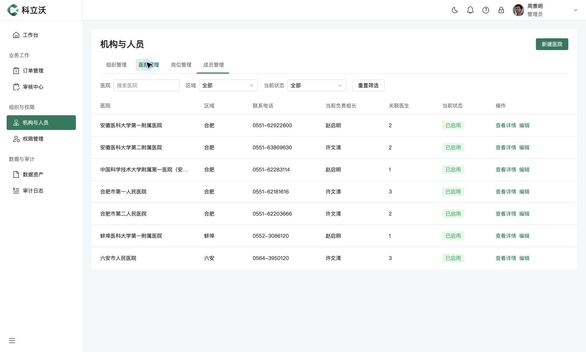
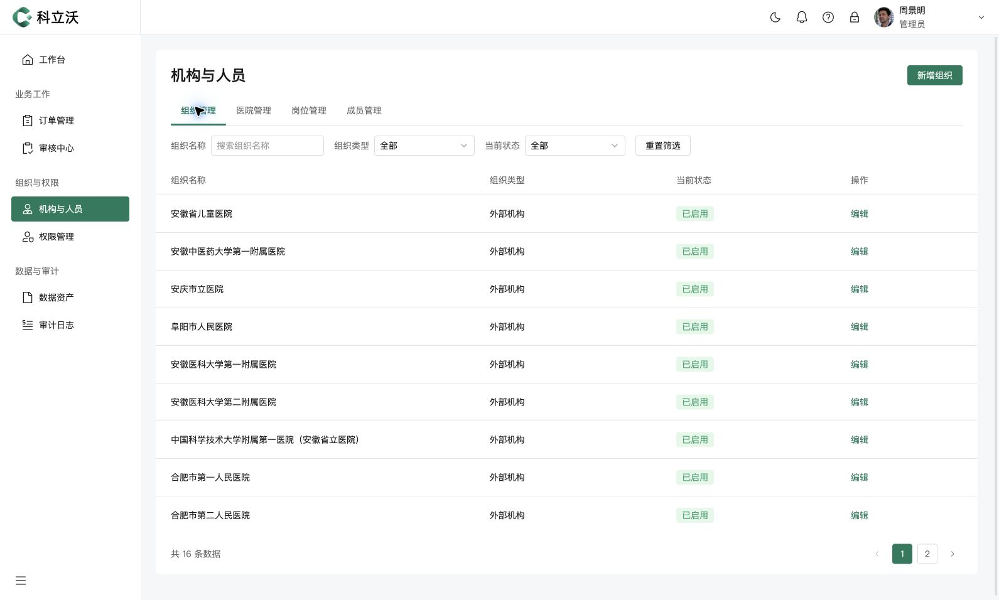
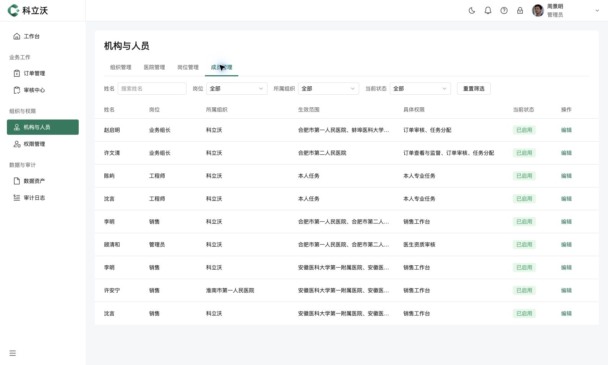
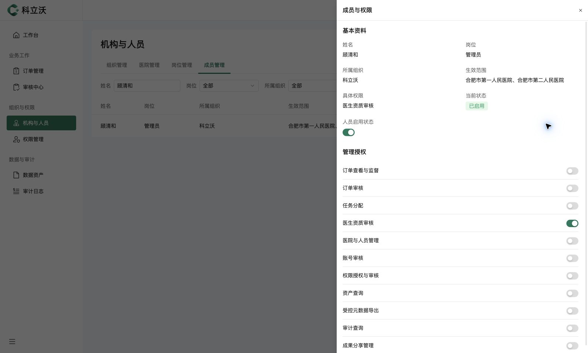
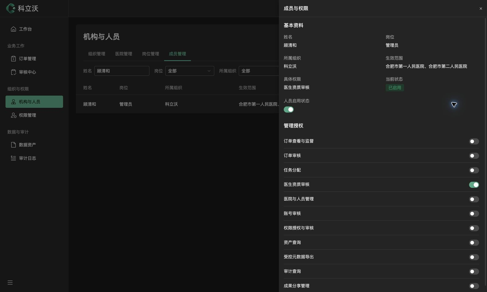

# 机构、医院、岗位及成员定向修正｜2026-11-26

基线：`2bc1fb082a837e8a3cb67647ee7490737c53a754`。工作分支：`codex/review-corrections-20261125`。
安全分支：`codex/backup-institutions-20261126-2bc1fb0`。运行数据另备份于本机私有临时目录，未入库。

## 完成结果

- Tab顺序：组织管理、医院管理、岗位管理、成员管理。
- 岗位增加岗位名称和当前状态组合筛选；新增岗位仍在标题行。
- 成员筛选：姓名、岗位、所属组织、当前状态；表头：姓名、岗位、所属组织、生效范围、具体权限、当前状态、操作；操作仅编辑。
- 成员通过稳定Organization ID读取目录名称；已知演示员工归属科立沃，保留既有真实组织ID。范围和权限使用固定列宽、单行省略与Tooltip。
- “成员与权限”抽屉包含基本资料和管理授权Switch；不再展示操作记录。实际权限、账号启停和审批规则保持不变，权限申请不会直接开启授权；真实认证账号的启停仍受现有服务端能力限制。
- 当前目录16个组织：科立沃及15家安徽医院，合肥医院占多数。医院管理7家医院均有完整联系电话。
- 医院ID、组织ID、Doctor/Order/Project/Task关联保持稳定；迁移只作用于已知隔离演示记录。人工后续改名或正式环境不自动覆盖，不合并同名医院，不重写申请快照或业务审计。

## 医院联系电话

| 医院 | 区域 | 联系电话 |
| --- | --- | --- |
| 安徽医科大学第一附属医院 | 合肥 | 0551-62922800 |
| 安徽医科大学第二附属医院 | 合肥 | 0551-63869630 |
| 中国科学技术大学附属第一医院（安徽省立医院） | 合肥 | 0551-62283114 |
| 合肥市第一人民医院 | 合肥 | 0551-62181616 |
| 合肥市第二人民医院 | 合肥 | 0551-62203666 |
| 蚌埠医科大学第一附属医院 | 蚌埠 | 0552-3086120 |
| 六安市人民医院 | 六安 | 0564-3950120 |

电话采用ASCII短横线分隔。蚌埠及六安号码按公开号码原有7位本地号保留，不伪造第8位。公开资料只用于合成业务目录，不表示医院与平台存在正式合作关系。

名称及电话来源（2026-11-26核对）：

- 安徽医科大学第一附属医院：[医院常用电话](https://www.ayfy.com/cydh.htm)。
- 安徽医科大学第二附属医院：[国家卫健委公开医疗机构目录](https://www.nhc.gov.cn/fys/c100077/202201/eaaa3bbfbf4c44a18c96c34cd54c529f/files/1732845365025_98472.pdf)。
- 中国科学技术大学附属第一医院：[国家人口健康科学数据中心医院资料](https://csp.ncmi.cn/UsersInfo/UserUnit/UserUnitDetailWeb?uid=00540)。
- 合肥市第一人民医院：[医院官网联系电话](https://www.hfyy.cn/col204/list)。
- 合肥市第二人民医院：[就医指南电话](https://s.dayi.org.cn/mip/s/hospital/1058.html)。医院官网本次访问超时，号码采用公开医院指南，未冒称本次已打开医院官网。
- 蚌埠医科大学第一附属医院：[医院简介与咨询电话](https://www.byyfy.net/col6/index)。
- 六安市人民医院：[医院指南与预约电话](https://s.dayi.org.cn/mip/s/hospital/2291.html)。
- 其他组织名称：[安徽医科大学附属医院](https://www.ahmu.edu.cn/fzsfsyy/list.htm)、[安徽省第二人民医院](https://www.ahsph.cn/)、[淮南卫健委机构名单](https://wjw.huainan.gov.cn/ztwz/hnsjbyfkzzx/tzgg/551867800.html)、[国家卫健委目录](https://www.nhc.gov.cn/fys/c100077/202201/eaaa3bbfbf4c44a18c96c34cd54c529f/files/1732845365025_98472.pdf)。具体医院迁移前后名称与来源见[data-evidence.json](data-evidence.json)及源码显式映射。

## 实际验收

| 项目 | 结果 | 证据 |
| --- | --- | --- |
| Tab名称及顺序 | 通过 | 浏览器截图 |
| 医院列表7家完整电话 | 通过 | hospitals-light.png |
| 医院详情电话 | 通过 | hospital-details.png |
| 组织管理16条安徽医院/科立沃 | 通过 | 浏览器与服务端快照 |
| 岗位名称搜索“销售” | 通过 | roles-filter.png，仅1条 |
| 成员姓名搜索 | 通过 | 顾清和仅1条 |
| 成员岗位+组织组合筛选 | 通过 | 工程师+科立沃，陈屿和沈言2条 |
| 成员表头/仅编辑 | 通过 | members-light.png |
| 范围/权限省略 | 通过 | nowrap/ellipsis实测；范围内容308px、可用243px |
| 完整Tooltip | 通过 | member-scope-tooltip.png |
| 前三列及末列固定 | 通过 | 浏览器computed position:sticky及left/right实测 |
| 成员与权限字段/无操作记录 | 通过 | member-drawer-light.png |
| 授权Switch确认、取消不扩权 | 通过 | permission-confirmation.png；实际取消，未授予 |
| 授权请求、撤销、启停后端保护 | 通过 | 原有权限回归测试 |
| Light/Dark | 通过 | hospitals-dark.png、member-drawer-dark.png |
| 原订单/项目/任务/事件保留 | 通过 | 备份前后数据逐项对比 |
| 三端医院名称与业务关联 | 通过 | 当前数据副本服务快照逐条核对；详见data-evidence.json |
| 销售和设计师全部UI重新逐页点击 | 未实际验证 | 本轮未修改这些UI，专业工作区未触碰；不冒称全页浏览器回归 |
| TypeScript/Vite | 通过 | 构建成功；保留既有大资源chunk警告 |
| 43项定向回归 | 通过 | 6个测试文件，无失败 |
| 部署、main、design-handoff、冻结基线 | 未修改 | 只在当前工作分支本地改动 |

当前共享数据：销售23条订单、17个设计师项目、43条总任务；其中陈屿授权29条任务，逐条Order→Project→Task与医院目录关联检查通过。迁移前后共享订单/项目/任务/事件完全一致，医生资料、目录业务事件和销售范围完全一致。目录迁移before/after另存catalogMigrations，不充当业务操作记录。

## 截图

## 修改文件

- server/unified/anhuiDemoDirectory.mjs：有来源的隔离目录映射及幂等迁移。
- server/auth/organizationDirectory.mjs：初始目录及稳定医院组织链接名称同步。
- server/admin/service.mjs：目录迁移接入与成员组织读取。
- src/admin/AdminWorkspace.tsx：指定Tab、成员筛选、表头及抽屉。
- src/admin/RolePanel.tsx：岗位筛选。
- src/admin/institutionRules.mjs / institutionRules.d.mts：筛选规则及类型。
- AGENTS.md、design-system/ui-ux-consistency.md、docs/product/field-dictionary.md：本轮规范同步。
- tests/institutions-members-20261126.test.mjs：迁移/筛选/关联保护测试。
- tests/admin-service.test.mjs：医院维护测试读取实际版本，保留过期版本拒绝检查。
- tests/review-organization-20261125.test.mjs：组织名称断言读取目录，不固定旧名称。
- tests/institution-scope.test.mjs：冻结范围对照本轮真实起始基线。
- 本目录：截图、验收报告及不含凭据的关联证据。

本地预览：http://127.0.0.1:5260/ 。仅本机使用，未部署。
