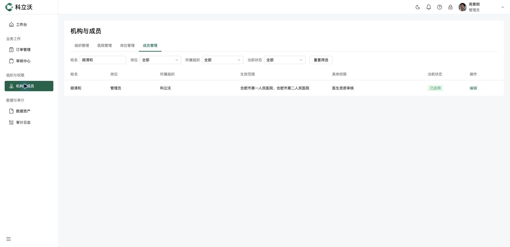
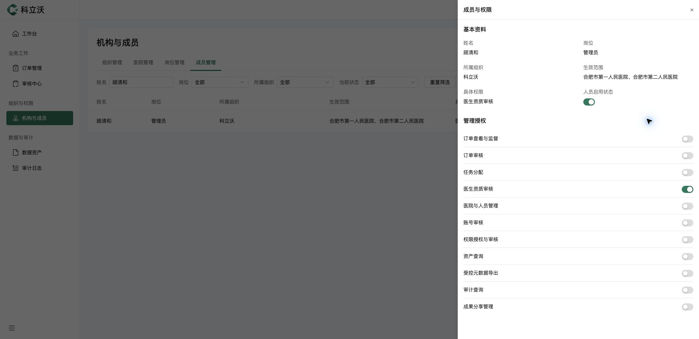
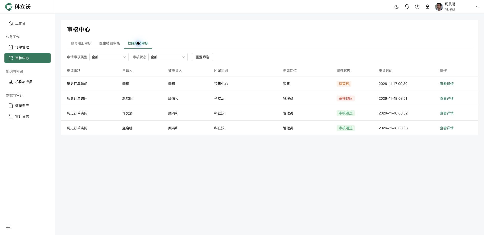

# 删除独立权限管理｜2026-11-26

基线：e9988b1c616cb6949482d80e68fbbeb43e8253b7。
安全分支：codex/backup-remove-permissions-20261126-e9988b1。

- 删除管理员侧栏独立权限管理项、当前权限/权限变更记录页面及专用模块配置。
- 成员授权保留在机构与成员→成员管理→成员与权限；权限申请审核保留在审核中心；历史变更保留在审计日志。
- 旧 #admin/permissions URL已在浏览器验证转至 #admin/organizations，无空白页。
- 浏览器实际验证菜单不存在权限管理、成员授权抽屉可打开、权限申请审核可打开、审计日志有记录。
- TypeScript与Vite构建通过，保留既有大资源chunk提示；没有修改服务端、权限数据、审核规则、其他角色业务、全局Token或部署。
- 本轮未提交任何授权变更或审核操作，仅验证入口及现有记录。

修改文件：src/admin/AdminWorkspace.tsx、AGENTS.md、design-system/ui-ux-consistency.md、docs/product/field-dictionary.md及本目录验证截图。

