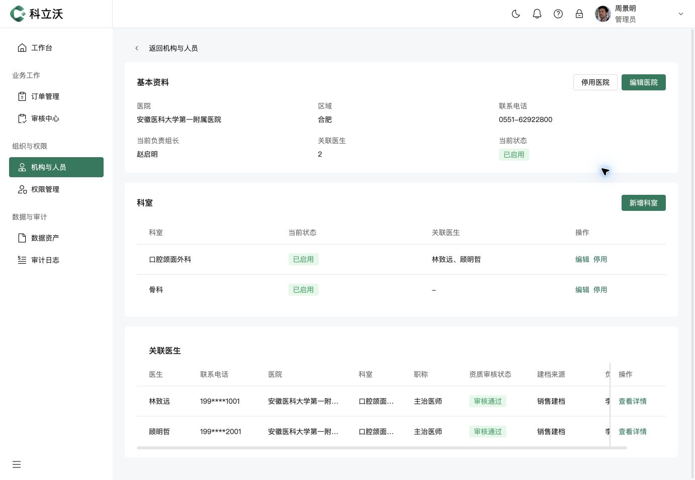
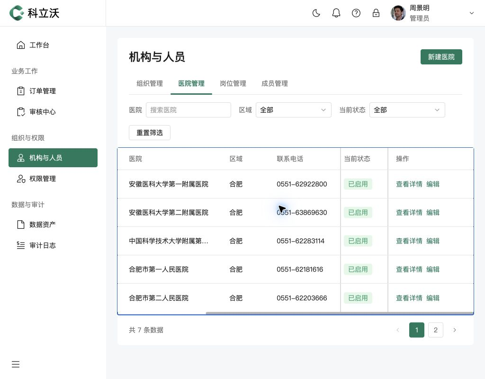
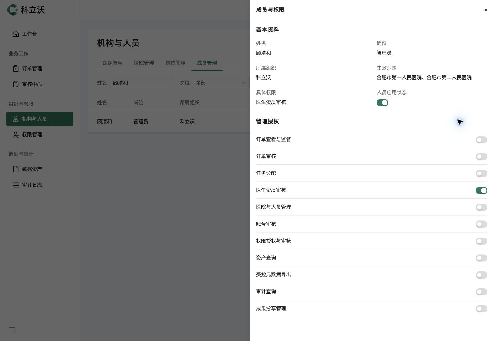

# 管理端三项定向修正｜2026-11-26

基线：5b3c9b959ec501100330a4c24d9794478c5ad3e3。
安全分支：codex/backup-admin-three-fixes-20261126-5b3c9b9。

1. 医院详情基本资料按钮：左侧停用/启用医院（次按钮），右侧编辑医院（主按钮）。浏览器实测停用按钮x=1140、编辑按钮x=1236，两者宽度均88px，操作逻辑未改。
2. 首列冻结修复：旧`.app-table td:first-child {position:relative}`覆盖TDesign固定单元格sticky。现仅普通首单元格继续使用此定位，固定列交还TDesign管理；不改列顺序、宽度、Token、数据和业务逻辑。
3. 成员与权限Drawer基本资料删除重复“当前状态”，保留人员启用状态Switch；成员列表状态列不变。

## 实测冻结列

视口1024×800，医院管理表格内容宽1000px、可用宽752px。实际拖动水平滚动条，从scrollLeft=0到248：

| 数据/表头列 | 滚动前x | 滚动后x |
| --- | --- | --- |
| 医院 | 248 | 248 |
| 区域 | 468 | 468 |
| 联系电话 | 568 | 568 |
| 当前负责组长 | 718 | 470 |
| 关联医生 | 848 | 600 |
| 当前状态 | 958 | 710 |
| 操作 | 820 | 820 |

表头及第一条实际数据行坐标分别测量，一致通过。完整原始测量见fixed-column-measurements.json。没有仅根据fixed配置或表头样式宣称通过。临时视口覆盖已恢复。

## 验证

- 医院详情按钮顺序、主次样式：浏览器通过。
- 1024px实际横向滚动，前三数据列和末列固定：浏览器通过。
- 成员Drawer无重复状态、保留开关：浏览器通过。
- TypeScript、Vite构建：通过；既有大资源chunk提示仍存在。
- 保护范围测试：通过，只允许本轮指定的共享CSS首列修正，其他冻结页面及全局样式保持原样。
- 未逐页重测全部角色页面，不冒称所有页面浏览器回归通过。
- 未改服务端、业务数据、销售/设计师业务组件、Token、Header或专业工作区；未推送、未部署。

修改文件：src/admin/AdminWorkspace.tsx、src/index.css（仅首列定位选择器）、design-system/ui-ux-consistency.md（对应规则）、tests/institution-scope.test.mjs（当前授权基线及共享CSS最小变更保护），以及本目录截图和测量证据。

