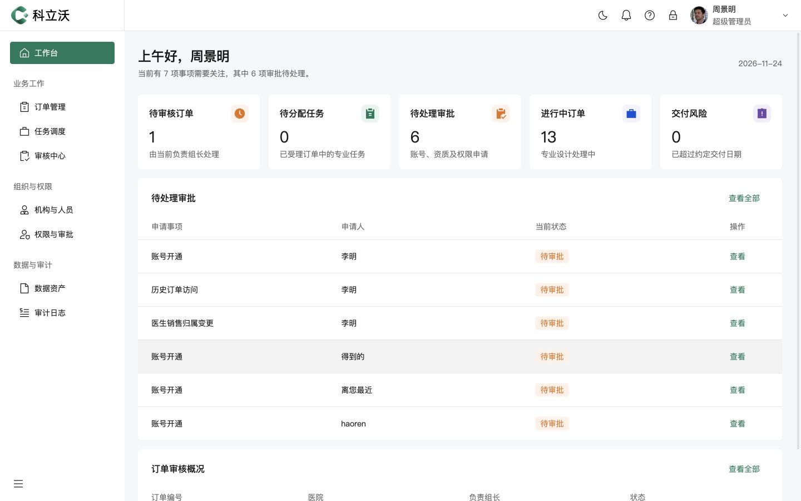
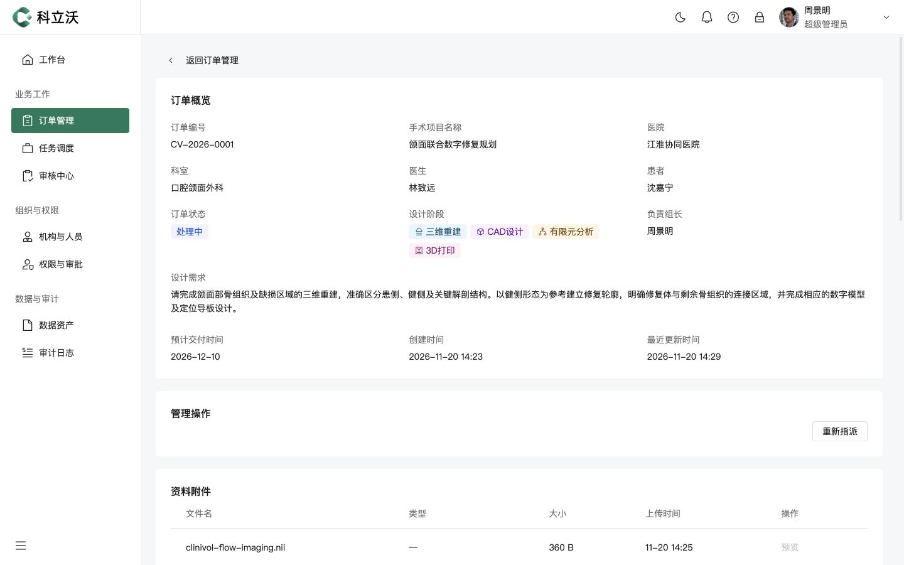

# 管理员端截图索引

日期：2026-11-24。前后对照均使用1440×900视口。业务写入只在隔离QA副本，最后原数据预览见下方独立截图。

|页面|修改前|修改后 Light|修改后 Dark|
|---|---|---|---|
|工作台|[前](./before-home.png)|[后](./light-0.png)|[深色](./dark-0.png)|
|订单管理|[前](./before-1.png)|[后](./light-1.png)|[深色](./dark-1.png)|
|任务调度|[前](./before-2.png)|[后](./light-2.png)|[深色](./dark-2.png)|
|审核中心|[前](./before-3.png)|[后](./light-3.png)|[深色](./dark-3.png)|
|机构与人员|[前](./before-4.png)|[后](./light-4.png)|[深色](./dark-4.png)|
|权限与审批|[前](./before-5.png)|[后](./light-5.png)|[深色](./dark-5.png)|
|数据资产|[前](./before-6.png)|[后](./light-6.png)|[深色](./dark-6.png)|
|审计日志|[前](./before-7.png)|[后](./light-7.png)|[深色](./dark-7.png)|

## 当前预览（原数据快照）

## 订单详情对照

## 关键路径

- [必填原因校验](./command-required.png)
- [管理员退回订单](./order-returned.png)
- [销售读取相同订单退回原因](./sales-returned-order.png)
- [管理员受理同一订单](./order-accepted.png)
- [两个任务分配](./tasks-assigned.png)
- [设计师读取同编号项目](./designer-linked-order.png)
- [CAD上游阻断保留](./task-blocked.png)
- [医生退回原因校验](./doctor-return-validation.png)
- [医生退回记录](./doctor-returned.png)
- [资质合成资料预览](./doctor-preview.png)
- [隔离账号审批结果](./account-approval.png)
- [权限审批后生效](./permission-approved.png)
- [医院负责人变更](./hospital-leader.png)
- [资产追溯](./asset-trace.png)
- [元数据导出审计](./metadata-export-audit.png)
- [审计筛选重置](./audit-reset.png)
- [完整列表Empty120px](./empty-final.png)
- [折叠导航64px](./nav-collapsed.png)

## 多视口

- [Light 1366×768](./light-1366.png)
- [Light 1920×1080](./light-1920.png)
- [Dark 1366×768](./dark-1366.png)
- [Dark 1920×1080](./dark-1920.png)

上述两张较早的Dark多尺寸截图拍摄于最后一次选中文字对比度修正前；最终导航颜色以 [Dark最终工作台](./dark-home-final.png) 和八个模块1440×900最终截图为准。数值记录见visual-matrix.json。
