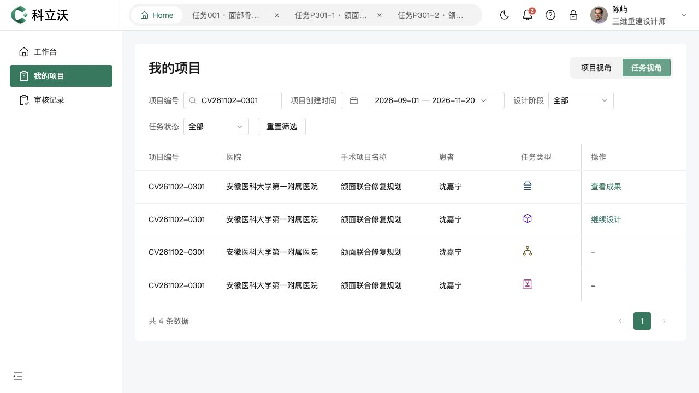
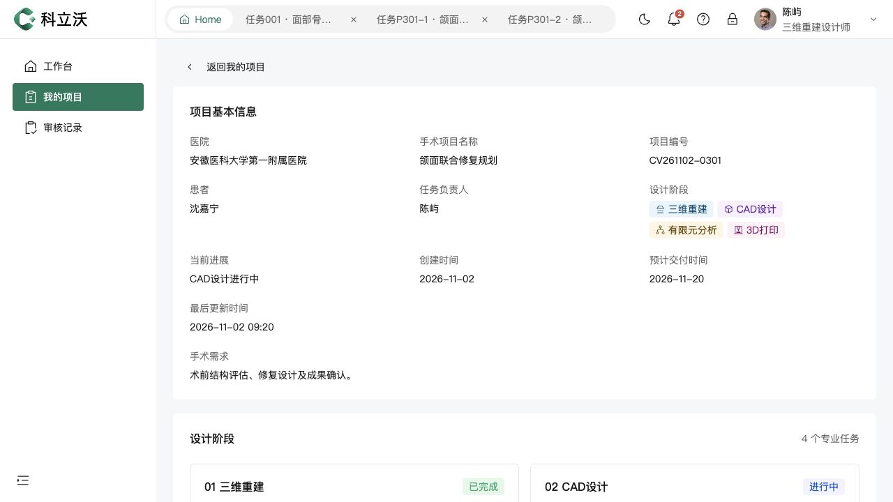
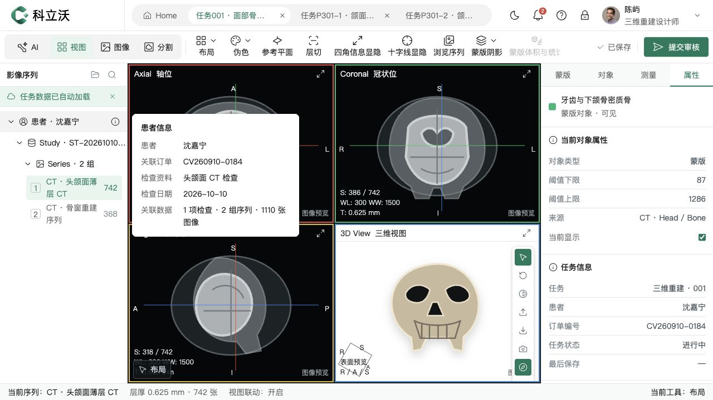

# 患者姓名展示统一（2026-11-20）

安全恢复点：182e15894868c81bfe3c615725b9afa700bcbb3e；分支codex/backup-before-patient-display-20261120。

本轮只更改“患者”可见字段与姓名值，不改布局、Token、审核、任务身份或专业工具行为。

## 涉及位置

- 首页“我的项目”、完整“我的项目”项目视角和任务视角：表头“患者”，值为姓名。
- 项目详情、三维重建任务详情、CAD任务详情及任务标题摘要：展示姓名。
- 三维重建影像树、患者信息浮层、属性面板：展示“患者”和姓名。
- 现有CAD组件本身没有患者标识展示，不作无关改动；管理员与销售原有字段不变。

src全量检索已无用户可见“患者标识”文案。技术文档中的内部患者标识概念仍保留，不把姓名改为关联键。

## 数据规则

读取Task.patientName；项目聚合继承同一患者引用的已有姓名。缺名的13个既有隔离演示项目按项目ID、Task ID、原患者引用固定匹配，复用销售已有合成姓名“沈嘉宁/顾清禾”。没有生成或宣称取得真实患者身份，也没有建立虚构的跨角色订单关联。已提供姓名优先；生产或未知记录缺名显示空值。Task.patient、patientRef、Order/Project/Task ID均原样保留，不迁移覆盖用户存储。

## 验证

- TypeScript通过；Vite构建通过，仅既有大chunk提示。
- 本轮患者显示3项+原定向修复5项测试共8/8通过，覆盖同项目多任务姓名一致、原始任务/CAD一致、真实字段优先、生产/未知身份不套用演示姓名、原ID不变及冻结范围校验。
- 浏览器实际验证：首页与双视角表头“患者”；CV261102-0301四条任务及项目详情均为沈嘉宁；原任务001属性“患者：沈嘉宁”，患者信息浮层与影像树一致。
- 无CSS/Token改动，未部署，未推送。

## 文件

src/projects/patientDisplay.ts、projectModel.ts、ProjectPages.tsx；src/App.tsx（仅姓名类型、展示与相关搜索）；design-system/component-rules.md、docs/product/field-dictionary.md；tests/patient-display.test.mjs、v38-sales-designer.test.mjs及本验收资料。

