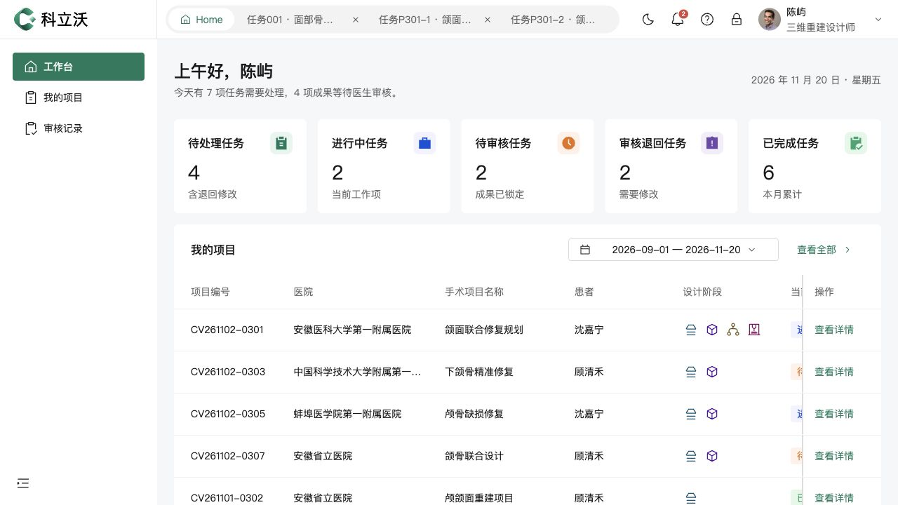

# 设计师端阶段字段名称统一（2026-11-20）

前一恢复点：58832f7。本轮仅把设计师端的阶段显示名称从“任务类型”改回“设计阶段”。

覆盖：首页我的项目、我的项目双视角、审核记录、三维重建/CAD任务详情、既有任务列表及相关筛选。底层taskType、图标、数据、列宽、布局、操作逻辑均不变。更新component-rules、ui-ux-consistency和字段字典以保持一致。

浏览器实际核对首页、项目视角、任务视角、审核记录表头均为“设计阶段”；src/projects及src/App.tsx检索不再出现“任务类型”。TypeScript及8项相关回归测试通过。未部署，未修改正式交付分支。

