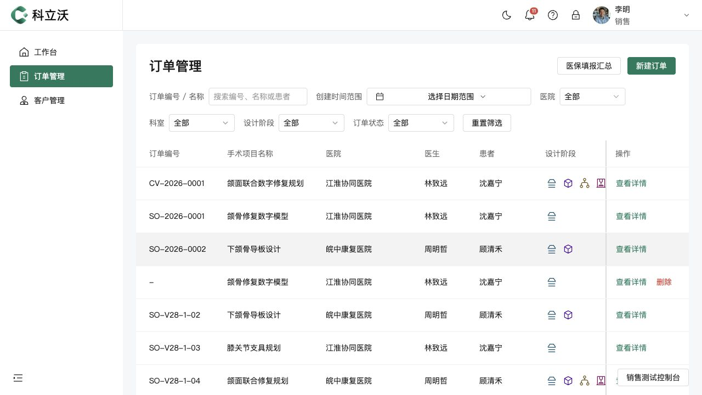
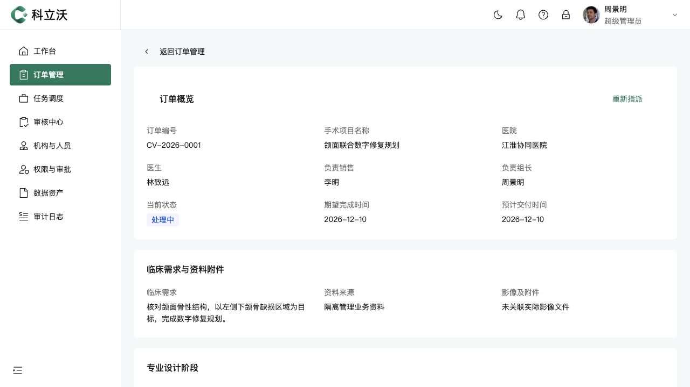
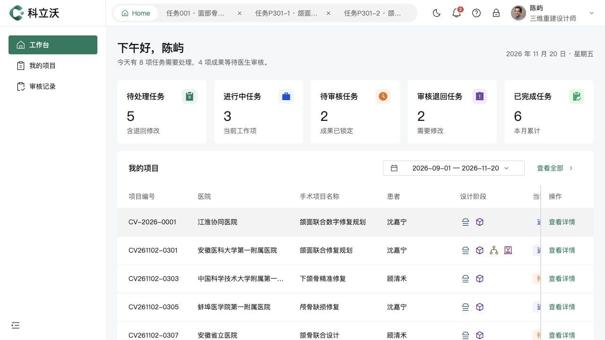

# 跨角色统一业务编号｜本地实现与验收

日期：2026-11-20。分支：`codex/a-unified-business-20261120`。

本轮完成新增订单的服务端“提交→管理受理→建主项目→任务分配→设计师接收”共享链路。**尚未完成真实影像文件、工程成果及生产业务服务的全链路集成**，不能把下述通过项扩展为完整临床交付能力。

本地预览：[http://127.0.0.1:5260/](http://127.0.0.1:5260/)。只限本机，未部署、未推送。原登录与账号切换仍沿用现有机制，服务重启需重新登录；业务数据不会因此清空。

## 1. 改造前后

| 项目 | 原有实现 | 本轮实现 |
|---|---|---|
| 编号 | 草稿只隐藏内部ID；不同端有独立演示编号 | 新订单服务端首次成功提交分配businessNo；退回/重提保号，三个角色显示同号 |
| 主项目 | 销售SP-*与工程orderNo聚合各自存在 | 新链路同一个Order.id对应唯一Project.id；Project.orderId明确关联 |
| 专业任务 | 不同端保有各自演示任务 | 审核受理创建实际申请阶段，每个Task有独立UUID，按能力分配 |
| 数据存储 | 角色各自演示数据/浏览器状态 | 新业务只有一个本地服务端持久化文件；三端读其授权投影 |
| 历史 | 已有SO/ADM/CV等不同命名空间 | 保留旧号、旧身份、旧工程键，不按姓名或相似编号合并 |

销售UI缓存不是新共享业务的权威来源。服务器保存失败会反馈错误，不回退到前端假成功。

## 2. 本次实际浏览器记录

在现有隔离测试账号中通过页面真实创建、上传、提交、退回、重提、受理与分配。未创建新账号、未修改密码或专业权限、未发送真实短信。

| 对象 | 实际记录 |
|---|---|
| 统一业务编号 | `CV-2026-0001` |
| 内部Order.id | `SO-83c79ca9` |
| 内部Project.id | `PRJ-20cfddf0-7b75-4fa9-8356-e0c5049ff8f6` |
| 三维重建Task.id | `TASK-f757aff0-4bd4-4b10-8294-9e47ffcf0065` |
| CAD Task.id | `TASK-eb90be46-2d77-470e-b151-ee0ca49878ba` |
| 有限元Task.id | `TASK-be047644-f1f5-41bd-afc7-832aa84ca84f` |
| 打印Task.id | `TASK-b07c14b1-ebe9-4aeb-a8e0-9d3ba67a8572` |

实际记录数量：1订单、1项目、4任务。陈屿保留原三维重建/CAD能力，接收其中2任务；有限元/打印分配给已有相应能力人员沈言。没有为了让陈屿看四行而扩大其权限。

14:23保存草稿；14:25正式提交；14:27管理员接管并退回；14:28销售修改后再次提交；14:29受理；14:29–14:30分配四任务；14:31陈屿按真实Task ID开始三维重建。之后重启服务并分别重新登录三角色，同一业务与关联保留。

附件为360字节的合成NIfTI测试文件，没有真实患者资料。新链路只保存附件引用，**该文件尚未作为Series接入专业影像读取**。

脱敏ID证据：[chain-ids.json](chain-ids.json)。本机私有业务库不提交Git，不包含账号密码、验证码或密钥。

## 3. 字段映射

| 角色/用途 | 显示值 | 路由与关联身份 |
|---|---|---|
| 销售订单编号 | Order.businessNo；草稿`-` | Order.id |
| 管理订单编号 | 同一Order.businessNo | 同一Order.id |
| 设计师项目编号 | Project.orderId→Order.businessNo | Project.id |
| 任务视角项目编号 | Task.projectId→Project.orderId→Order.businessNo | Task.id |
| Task.orderNo | 不作为新业务展示编号 | 兼容映射为内部Project.id，保留旧任务/事件/工程键 |
| 成果与事件 | resultId/version、实际操作人/时间 | orderId/projectId/taskId，事件ID独立 |

正式提交之前没有Project/Task。受理事务内创建一个Project及所需Task；重复受理不能生成另一项目。新任务的上游门禁取服务端真实状态，未出现正式成果前不自动解锁CAD。

## 4. 16项验收

“通过”区分浏览器实测与自动化证据；“部分通过”明确未接入范围，不计为全链路完成。

| # | 验收项 | 结果 | 实际证据与限制 |
|---|---|---|---|
| 1 | 销售创建草稿显示`-` | 通过：浏览器 | 01-sales-draft.png；仅内部ID存在 |
| 2 | 保存并再次打开草稿 | 通过：浏览器+服务测试 | 页面刷新后仍是同一内部订单，无正式号 |
| 3 | 首次提交唯一正式号 | 通过：浏览器+HTTP | CV-2026-0001；分配与状态变更同一落盘事务 |
| 4 | 重复请求不重复编号/订单 | 通过：HTTP并发测试 | 同一会话5个并发提交均返回同号；落盘1订单，流水仅增加1 |
| 5 | 管理员查询同一销售订单 | 通过：浏览器 | 按CV-2026-0001过滤，实际内部ID相同；03、16截图 |
| 6 | 管理员退回保号 | 通过：浏览器 | 真实填写退回原因；04截图 |
| 7 | 销售修改重提保号 | 通过：浏览器 | 修改临床需求后再次提交仍CV-2026-0001；05截图 |
| 8 | 审核通过只建一个主项目 | 通过：浏览器+服务测试 | 落盘1项目；重复受理409，不再创建 |
| 9 | 四任务独立ID | 通过：浏览器 | 06、16截图及chain-ids.json；按真实能力分配 |
| 10 | 设计师项目编号同销售 | 通过：浏览器 | 项目视角1行CV-2026-0001；08、14截图 |
| 11 | 四授权任务同号、阶段顺序 | 通过：自动化；完整四行浏览器未验证 | 使用有四阶段能力的临时测试身份验证1项目4行/4独立ID。实际陈屿只拥有2项，浏览器正确显示三维重建、CAD两行（09），未扩大权限 |
| 12 | 不同任务独立入口 | 部分通过 | 新三维重建UUID正确进入及刷新恢复（10）；新CAD因上游未通过正确阻断。四条Task操作ID/顺序已自动化验证；四阶段专业界面全程操作未验证 |
| 13 | 成果/审核/操作日志关联 | 部分通过 | 实际订单审核与任务日志保留orderId/projectId/taskId；待审成果元数据关联已在临时服务测试验证，未伪造审核通过。新订单真实工程成果上传/审核尚未接入 |
| 14 | 跨角色刷新、重新登录 | 通过：浏览器+持久化测试 | 最终服务重启后重新登录陈屿、李明、周景明，关联仍一致；14、15、16截图 |
| 15 | 旧项目/任务/工程文件 | 通过：指定回归；全部历史未逐条验证 | 原001重建序列及P301-2 CAD打开正常（11、12）；原CAD/auth/样式/资源源码哈希保护通过。未迁移所有旧项目 |
| 16 | 权限隔离 | 通过：HTTP+服务测试 | 未登录401、销售访问管理403、设计师访问销售403、他人订单/任务403、医院越界403、锁屏423；不信任body角色 |

额外验证：未填完整草稿可保存；删除未提交草稿保留真实删除事件；未知旧正式记录拒绝自动重新编号；原号保留；权限缺失不返回共享资产/审计；项目状态包含其他受让人的任务而不泄露其任务详情。

## 5. 三角色同号截图

### 销售：正式提交/受理后的同一订单

### 管理：同一订单与四个独立任务

### 设计师：同一业务项目

其他过程截图：

- [草稿无编号](01-sales-draft.png)、[首次提交](02-sales-submitted.png)、[管理员查询](03-admin-same-order.png)
- [管理员退回](04-admin-returned.png)、[销售再次提交](05-sales-resubmitted-same-number.png)、[四任务分配](06-admin-four-tasks.png)
- [项目视角](08-designer-project-view.png)、[任务视角](09-designer-task-view.png)、[新任务独立路由](10-new-task-independent-route.png)
- [原三维重建](11-legacy-reconstruction-unchanged.png)、[原CAD](12-legacy-cad-unchanged.png)、[深色模式](13-designer-dark.png)

## 6. 构建与回归

- TypeScript：通过（已安装的TypeScript执行`tsc -b`）。
- Vite：通过（`vite build`，7.47秒）；保留既有大包警告，未扩大本轮范围拆包。
- 相关数据/HTTP/权限/历史兼容/前端投影/旧销售及管理回归：**88通过、0失败**。详见[regression.log](regression.log)。
- [build.log](build.log)保留最终Vite输出。pnpm启动时尝试自动检查/安装依赖，受环境限制失败；未更新依赖，改用项目已安装的相同TypeScript/Vite命令完成构建。
- 源码保护测试：原Header、Sidebar、专业工作区主体除展示编号读取外与修改前一致；CAD目录、auth目录、CSS、Token及其余冻结文件哈希不变。
- 浏览器操作采用真实页面控件，未通过修改localStorage制造三端记录。表单上传使用合成文件，管理审核仅作用于本轮明确新建的隔离订单。

## 7. 旧数据与尚未完成的集成

1. **旧记录不是全部打通。** 原ADM演示订单与原工程CV项目无可靠对应Order ID，继续隔离保留。未知历史订单不能自动迁移、不能批量重编号；需提供可信ID映射。
2. **预置退回订单按明确ID兼容。** 仅本地已登记fixture在下一次保存/提交时保留旧正式号进入共享服务。保留原浏览器事件，不补造旧审批。服务测试覆盖保号及未知映射拒绝；未对所有旧退回订单逐条做浏览器提交。
3. **客户主数据接入未完成。** 本地可信目录覆盖已核对预置客户/账号。新邀请医生审批后的主数据尚未自动进入共享业务目录，不接受前端自报审核通过扩权。
4. **影像与工程成果未贯通。** 原销售私有文件引用保留，新任务series为空，页面显示“关联影像暂不可用”。未把示意模型当真实患者模型。缺影像时阻止新任务提交成果；正式成果审核、锁定、发布与下游解锁需接真实专业服务。
5. **生产存储未接入。** 本轮是local-only文件事务服务，非分布式数据库；生产数据库、正式权限目录、可靠审计和文件授权仍需开发接入。没有部署此接口。
6. **专业原型能力边界不变。** FEA/3D打印原专业界面未重做；新任务的完整专业操作未浏览器验证。

## 8. 修改文件

| 类别 | 文件与目的 |
|---|---|
| 统一服务（新增） | server/unified/service.mjs：编号事务/唯一关系/角色投影/真实事件；directory.mjs：明确的隔离主数据与旧号登记 |
| 现有管理接入 | server/admin/http.mjs：本地同源认证业务路由；service.mjs：共享收单/受理/分配及快照合并；dev.mjs：复用指定本地端口 |
| 前端适配（新增） | src/business/unifiedClient.ts；useUnifiedDesigner.ts：读取同一服务，缓存保留原资料，不跨角色复制 |
| 销售 | src/sales/SalesWorkspace.tsx、model.ts、orderNumber.mjs、orderNumber.d.mts：服务端保存/提交/删除、字段兼容与正式号展示 |
| 管理 | src/admin/AdminWorkspace.tsx、model.ts：必要编号显示/筛选数据绑定，原布局不变 |
| 设计师 | src/App.tsx、src/projects/projectModel.ts、ProjectPages.tsx：授权任务接收、ID路由、分组筛选、同号展示 |
| 测试 | tests/unified-business.test.mjs、unified-business-http.test.mjs、unified-business-projections.test.mjs；更新v38-sales-designer.test.mjs冻结保护范围以匹配本轮明确数据适配授权 |
| 规范 | docs/product/field-dictionary.md、design-system/ui-ux-consistency.md、docs/DATA_AND_API_HANDOFF.md、docs/admin/v38/HANDOFF.md |
| 验收 | 当前目录报告、实际截图、脱敏ID及测试/构建日志 |

未修改全局Token、样式表、Header/Sidebar结构、CAD源码、专业模型、原影像文件、登录系统。未更新main、design-handoff或历史Tag，未部署。

## 9. Git恢复

- 修改前安全提交：`2cef945f91353752fe0c2f682f5303ab00ffb0af`。
- 安全分支：`codex/backup-before-unified-business-20261120`。
- 本轮工作分支：`codex/a-unified-business-20261120`，最终提交见本分支`git log -1`及交付回复。
- 没有强推、清理、覆盖或迁移原线上项目。
