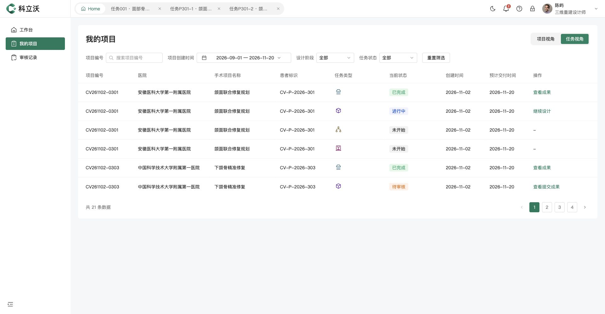
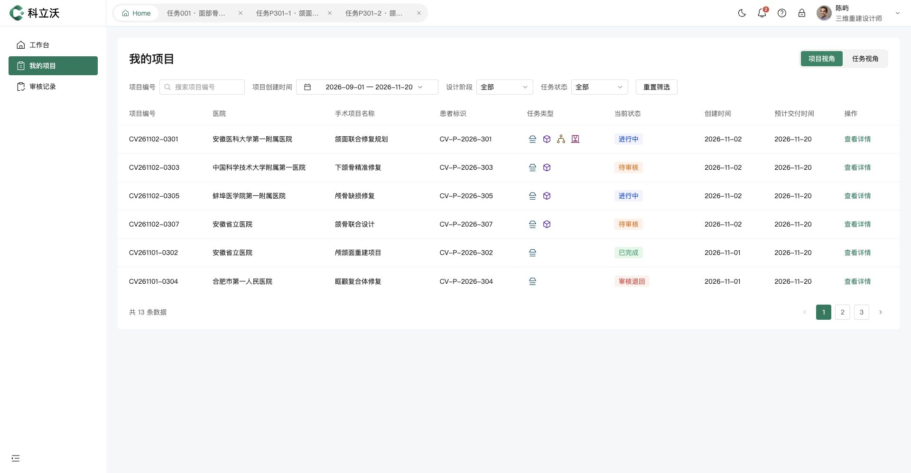
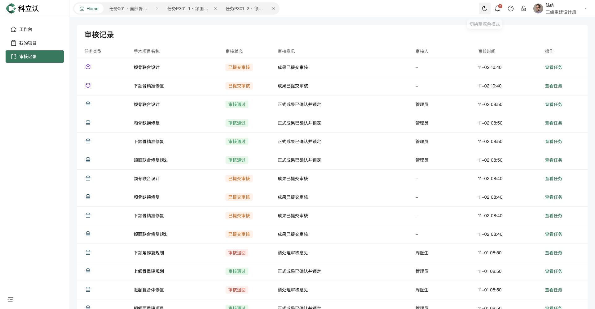
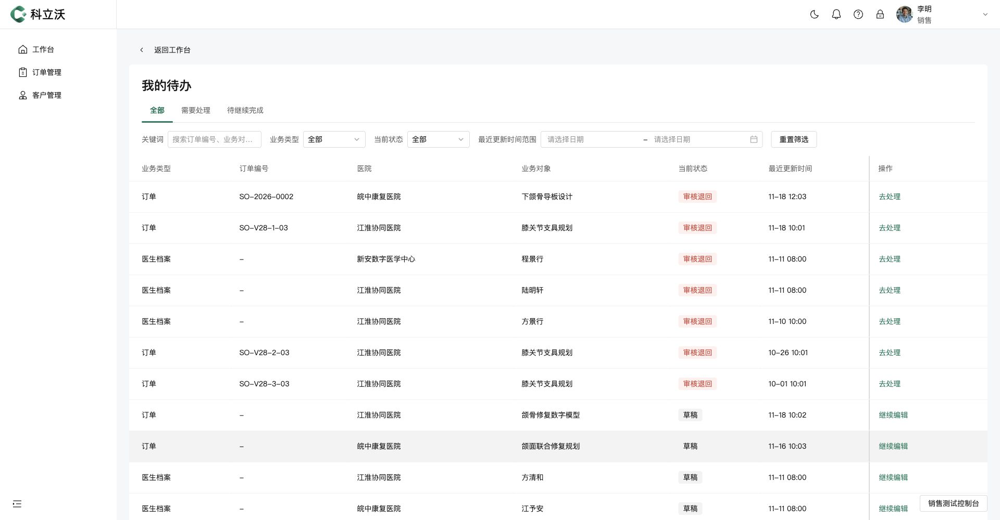
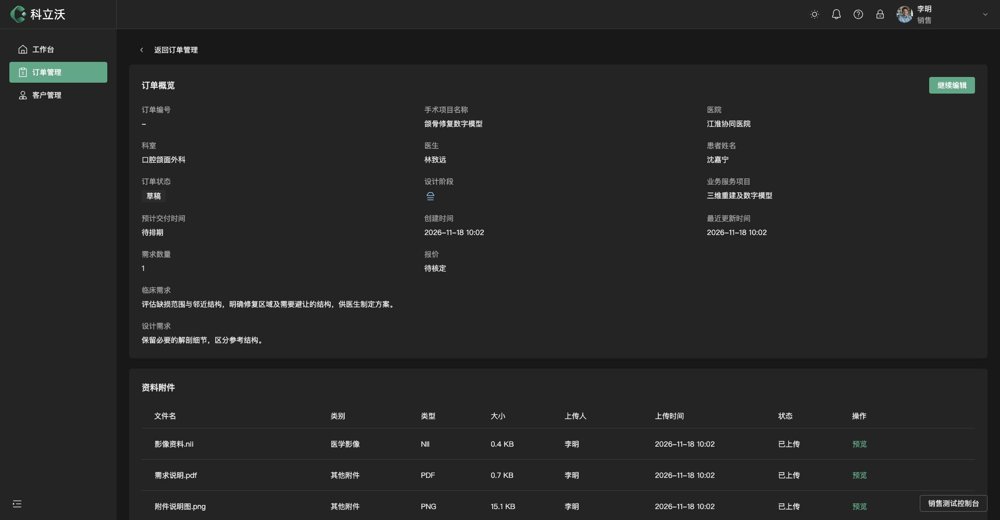

# V3.8 销售端与设计师端定向修复验收

日期：2026-11-20。基线：`e973bd7853b935d782daecc0d297c02f12927c77`。

安全恢复分支：`codex/backup-v38-before-sales-designer-20261120`（同基线）。修复分支：`codex/a-v38-sales-designer-20261120`。原恢复工作目录与5230预览保留。

本地预览：[http://127.0.0.1:5260/](http://127.0.0.1:5260/)；本地隔离认证服务5261。未推送、未部署、未修改main/design-handoff/历史Tag。

## 修复与边界

- `orderNumber`统一草稿正式编号为ASCII `-`；非草稿保持既有历史编号，支持显式业务编号字段。内部ID、rowKey、保存/编辑/删除/路由/关系保持。订单列表、近期、详情、关联订单表、受限订单编号共用规则。
- 完整待办三Tab共享七列、四种实际对象；医院按hospitalId、目标按稳定ID。搜索只匹配可见编号/业务对象/医院；首页保持原四列摘要与数量。本人尚未填写医院的医生草稿可显示`-`，不放入其他医院假数据。
- 近期订单状态表头改为“当前状态”。
- 设计师双视角共九列；任务继承项目的ID/医院/名称/患者/创建/交期，Task ID及负责人保留数据层。项目间稳定排序、项目内固定四阶段顺序；首筛选只查项目编号。
- 三张表共用既有阶段SVG及Tooltip，项目多个、任务/审核单个，不再显示文字Tag；详情StageLabel保持。
- 审核表七列，提交事件审核人`-`，实际决定者按事件身份显示，提交者/原actor/事件ID保留；真实时间倒序与真实Task跳转保持。
- 操作单元格与表头左对齐，局部移除文字按钮的额外水平Padding/透明边框，无Margin/位移补丁，TDesign原固定列及滚动继续有效。

### 仍需服务端数据机制

1. **本轮没有实现真正的提交时业务编号分配。** 当前非草稿兼容已有`Order.id`中历史编号，不重编。后续需独立业务编号、首次提交的事务/唯一性/幂等分配，退回重提保留原号。这不是已完成的后端能力。
2. **原始5个工程项目没有独立的项目约定交付日期字段。** 这两张指定列表不再把Task.deadline冒充项目交期，显示既有空值`—`。8个隔离目录项目沿既有明确项目交期2026-11-20。项目详情现有布局与历史数据不在本轮重写，后续需由真实项目记录提供agreedDueAt。

## 15项验收

| # | 要求 | 结果与实际证据 |
|---|---|---|
| 1 | 草稿编号/保存编辑删除提交重提 | 通过：浏览器近期/列表/详情为`-`，编辑路由仍为SO-V28-1-01；隔离状态测试覆盖新建、保存、编辑、删除、提交、退回、保存重提。未在浏览器删除已有业务订单。 |
| 2 | 提交/退回保留编号 | 通过：SO-2026-0002、SO-V28-1-03正常；状态测试退回重提不丢号、不变内部ID。 |
| 3 | 四类待办 | 通过：全部14条，第一页12/第二页2；需要处理7、待继续完成7，含订单与医生。七列表头一致。 |
| 4 | 同名医生不同医院定位 | 通过（隔离数据/路由测试）：同名医生两个稳定ID分别查两个hospitalId，route独立；浏览器实际另核程景行→doctor-new/D26-3及新安数字医学中心。未在浏览器额外创建同名医生。 |
| 5 | 近期订单表头 | 通过：浏览器显示当前状态，草稿编号`-`。 |
| 6 | 双视角表头一致 | 通过：浏览器九列逐项相同；无任务编号/独立负责人列。 |
| 7 | 四阶段连续展开 | 通过：CV261102-0301前四行依次重建/CAD/分析/打印，随后才下一个项目。 |
| 8 | 独立Task操作 | 通过：重建点击打开#workspace/P301-1，CAD点击打开#cad/P301-2；后两项未开始显示`-`，四个底层Task ID独立。没有放宽未开始阶段权限。 |
| 9 | 无任务编号列 | 通过：任务视角与审核记录DOM表头均不含任务编号。 |
| 10 | Icon-only及Tooltip | 通过：三表图标数与阶段一致，SVG文件不变、透明背景；浏览器浮层实际显示“三维重建”。 |
| 11 | 审核身份/意见/时间 | 通过：浏览器24条审核记录，提交记录审核人`-`、通过/退回保留实际记录人；测试覆盖具名reviewerIdentity、原actor/submitter、镜像eventId及时间倒序。未改变审计源。 |
| 12 | 操作文字左对齐 | 通过：18组浏览器测量均0px；1366横向滚动331px后仍0px，操作列position:sticky。 |
| 13 | 两主题/三宽度 | 通过：设计师三表与销售待办在1366/1440/1920、Light/Dark均实际渲染；document无横向溢出，表内按既有固定列横向滚动。截图见下方。 |
| 14 | 其他页面保持 | 通过（变更范围与关键路径）：Sales首页/订单详情/医生编辑、陈屿重建/CAD、账号切换恢复均实际打开；源码保护测试验证其他业务实现未变。未重新执行所有专业几何命令或全部上传/PACS流程。 |
| 15 | 管理员及专业工作区Diff | 通过：基线SHA256比对，管理员/auth/专业工作区/图标/Token源码一致；App除Reviews和必要导入外逐字一致，ProjectDashboard及详情函数逐字一致。 |

## 浏览器实测操作列

Range测量实际文字范围；单位CSS px。三表th/td外部Padding保持，不用位移对齐。

| 表 | 主题 | 视口宽度 | 表头文字X | 按钮最大偏差 | 页面横向溢出 |
|---|---|---:|---:|---:|---|
| projects | light | 1366 | 1246.984 | 0.000 | 无 |
| projects | light | 1440 | 1320.984 | 0.000 | 无 |
| projects | light | 1920 | 1779.445 | 0.000 | 无 |
| projects | dark | 1366 | 1246.984 | 0.000 | 无 |
| projects | dark | 1440 | 1320.984 | 0.000 | 无 |
| projects | dark | 1920 | 1779.445 | 0.000 | 无 |
| tasks | light | 1366 | 1168.000 | 0.000 | 无 |
| tasks | light | 1440 | 1242.000 | 0.000 | 无 |
| tasks | light | 1920 | 1692.227 | 0.000 | 无 |
| tasks | dark | 1366 | 1168.000 | 0.000 | 无 |
| tasks | dark | 1440 | 1242.000 | 0.000 | 无 |
| tasks | dark | 1920 | 1692.227 | 0.000 | 无 |
| reviews | light | 1366 | 1232.000 | 0.000 | 无 |
| reviews | light | 1440 | 1306.000 | 0.000 | 无 |
| reviews | light | 1920 | 1749.336 | 0.000 | 无 |
| reviews | dark | 1366 | 1232.000 | 0.000 | 无 |
| reviews | dark | 1440 | 1306.000 | 0.000 | 无 |
| reviews | dark | 1920 | 1749.336 | 0.000 | 无 |

任务滚动测试：1366px，表内scrollWidth1425/clientWidth1094，scrollLeft由0到331，固定右列仍sticky，表头与按钮X均1168。

### 浏览器其他实际结果

- 陈屿→李明→陈屿恢复#cad/P301-2，原P301-1/P301-2标签均保留，销售未出现工程师标签。
- 审核第一条“查看任务”跳转`#project/CV261102-0307?taskId=P307-2`，不把同项目任务混成同一个对象。
- 项目编号输入“颌面联合修复规划”返回空；输入CV261102-0301返回4条；医院待办搜索“皖中康复医院”仅返回该院对应记录。
- 草稿详情正式订单编号`-`；继续编辑进入`#sales/order-new/SO-V28-1-01`，内部ID不变。

## 截图

完整主题/尺寸截图、待办两个状态Tab/第二页、阶段Tooltip与横向滚动均在screenshots目录；原始测量见designer-browser-measurements.json和sales-browser-measurements.json。

## 代码与文档清单

代码：
- src/sales/orderNumber.mjs / .d.mts：统一正式编号展示与待办可见字段搜索。
- src/sales/dashboardBusiness.mjs / .d.mts：待办医院/编号字段与稳定身份。
- src/sales/SalesWorkspace.tsx：编号/七列表头/待办搜索/近期状态文案，首页摘要列白名单。
- src/sales/OrderPages.tsx：详情正式编号。
- src/projects/ProjectPages.tsx：双视角表头/项目字段/单Icon/编号筛选。
- src/projects/projectModel.ts：只按项目编号筛选、组内阶段排序、显式项目约定日期来源。
- src/projects/designerTables.css：仅三张设计师表操作列文字对齐。
- src/reviewRecords.ts：实际审核人展示与eventId/submitter保留。
- src/App.tsx：仅Reviews表格及StageTypeIcon必要导入。
- tests/v38-sales-designer.test.mjs：身份/状态/筛选/排序/审核/冻结保护。

规范：design-system/icons.md、component-rules.md、ui-ux-consistency.md、docs/product/field-dictionary.md。

## 构建及测试

- TypeScript `tsc -b`：通过。
- Vite生产构建：通过；仅既有>500KB chunk提示，未借此拆包重构。
- 本轮针对性5项测试：全部通过（每项覆盖多个具体断言）。
- 既有销售、待办、迁移、订单、医生权限、管理员服务回归：通过。初次批量中两个HTTP测试受沙箱localhost监听权限影响中断；放行临时本地端口后顺序复测11项全部通过，没有改业务源码绕过测试。
- git diff --check：通过。
- 冻结源码哈希：未授权源文件逐字一致；详见scope-verification.json与测试。
- React检查：未新增异步请求/保存副作用/组件重挂载；稳定Task/Order/Doctor rowKey和操作ID保留；无新状态镜像。
- impeccable扫描仅报告App原有冻结医学蒙版颜色6项advisory，相关行本轮未改，不扩大范围修复。
- 未实际验证：所有浏览器品牌（本轮为内置Chromium）、完整生产后端编号分配、真实项目缺失交期数据、所有专业工具几何回归。本轮无部署。
